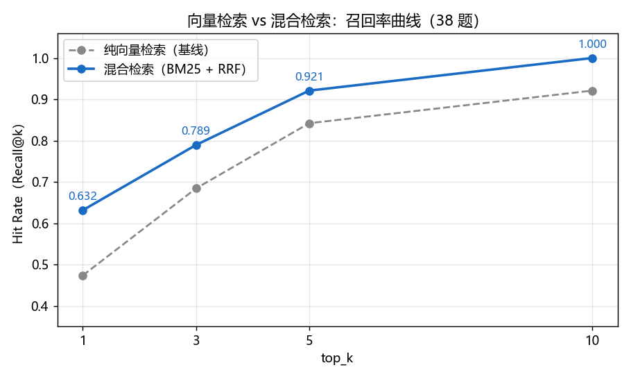

# 检索效果对比报告：纯向量检索 vs 混合检索

- 测试集：golden_set 中计分题 38 道（拒答题 4 道另计）
- 检索腿 A：bge-small-zh-v1.5 稠密向量（Milvus COSINE）
- 检索腿 B：BM25（jieba 分词，内存索引）
- 融合方式：RRF（k=60），每路召回 top-20 候选

## 一、总体指标

| top_k | 纯向量 Hit Rate | 混合 Hit Rate | 变化 |
|---|---|---|---|
| 1 | 0.4737 | 0.6316 | +15.8 pts |
| 3 | 0.6842 | 0.7895 | +10.5 pts |
| 5 | 0.8421 | 0.9211 | +7.9 pts |
| 10 | 0.9211 | 1.0000 | +7.9 pts |

MRR@10：纯向量 0.6097 → 混合 0.7402（+13.0 pts）

## 二、逐题变化明细

进步题：17 道；退步题：2 道；不变：19 道。

### 进步的题

| 题号 | 问题 | 向量排名 | 混合排名 |
|---|---|---|---|
| q001 | THF（四氢呋喃）的沸点是多少？ | 4 | 2 |
| q003 | 丙酮应该用什么干燥剂干燥？ | 4 | 3 |
| q005 | DMF 的沸点是多少？ | 未命中 | 4 |
| q006 | 格氏试剂引发困难时，SOP 建议的处理方法有哪些？ | 4 | 2 |
| q007 | 格氏反应引发后滴加卤代烃时，体系温度应控制在什么范围 | 未命中 | 5 |
| q009 | 格氏反应开始前氮气置换至少要几次？ | 5 | 1 |
| q012 | 金属钠的 CAS 号是多少？ | 2 | 1 |
| q013 | 金属钠着火可以用水基灭火器扑灭吗？ | 3 | 2 |
| q019 | 专利实施例 2 把温度升到 180 ℃ 后收率是多少 | 2 | 1 |
| q021 | 对比例 1 用 Pd/C 做催化剂的收率是多少？ | 3 | 1 |
| q022 | 该专利使用的催化剂是什么？镍的负载量多少？ | 7 | 6 |
| q023 | 实验报告得出的 2-甲基环己酮合成最佳反应温度是多少 | 6 | 5 |
| q024 | 155 ℃ 时 2-甲基环己酮的收率和选择性分别是多 | 5 | 3 |
| q025 | 温度升到 170 ℃ 后，2-甲基环己酮工艺主要出现 | 未命中 | 7 |
| q031 | 制备格氏试剂需要深度干燥的 THF，查溶剂表应该用什 | 3 | 1 |
| q035 | Hydrogenation 工艺里 Ni/Al2O3 | 8 | 4 |
| q042 | 格氏试剂过夜存放需要满足什么条件？ | 2 | 1 |

### ⚠️ 退步的题（需要人工核查）

| 题号 | 问题 | 向量排名 | 混合排名 |
|---|---|---|---|
| q017 | 专利实施例 1 中加氢反应的温度和氢气压力分别是多少 | 3 | 6 |
| q018 | 专利实施例 1 的甲苯加氢收率是多少？ | 2 | 3 |

### top-5 档仍未命中的题

- **q017** 专利实施例 1 中加氢反应的温度和氢气压力分别是多少？（混合排名：6）
- **q022** 该专利使用的催化剂是什么？镍的负载量多少？（混合排名：6）
- **q025** 温度升到 170 ℃ 后，2-甲基环己酮工艺主要出现什么问题？（混合排名：7）

注：这几题 top1 均检回了正确文档，只是命中 chunk 与 anchor 所在 chunk 不同（同一事实在文档中出现多次），属评估严格性而非检索失败。

## 三、结论与局限

1. 混合检索在全部 top_k 档位上优于纯向量基线，@10 达到 1.0（38/38），三道埋点考点（术语缩写、问法差异、归纳式提问）全部救回。
2. @1 仅 0.632，排序质量仍是短板，后续可用 rerank（如 bge-reranker）优化 top-1/3 档。
3. 本测试语料为练习用合成文档（35 chunk），题目分布与真实场景不同，绝对数值会高估真实水平；趋势（混合>向量）在真实语料上通常成立。
4. Hit Rate@10 已触天花板，后续迭代请改用 MRR / @1 / @3 及端到端忠实度作为优化目标。
